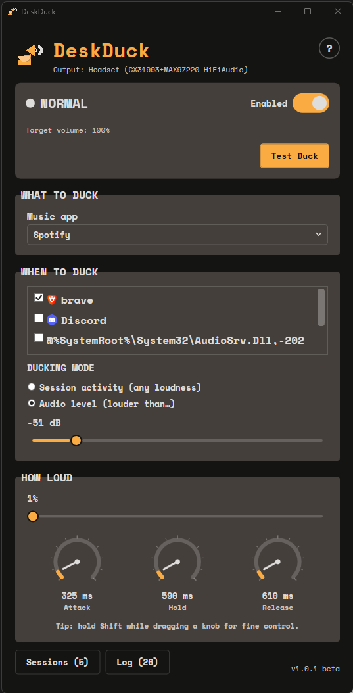
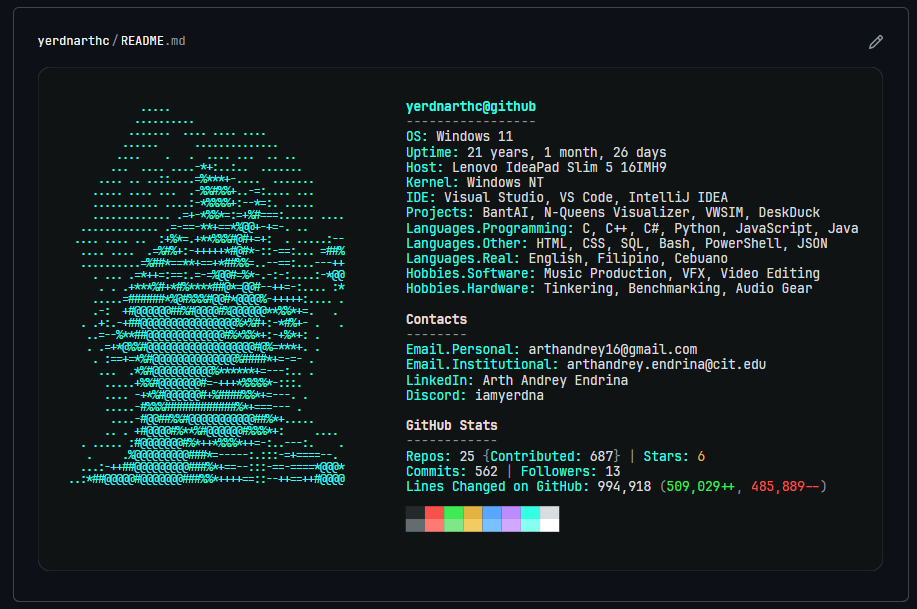
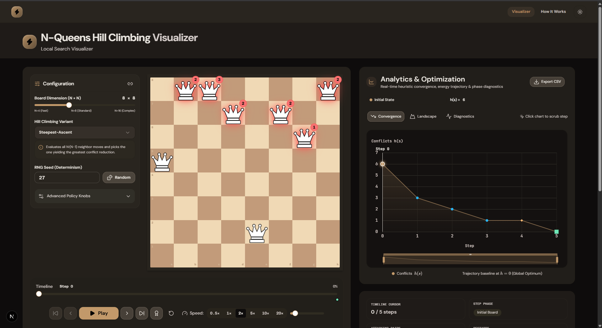
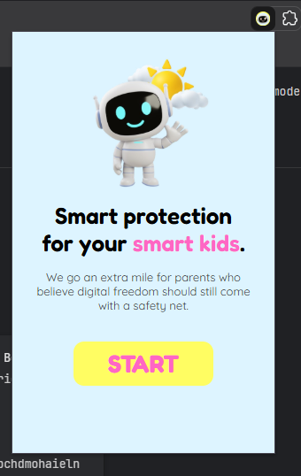
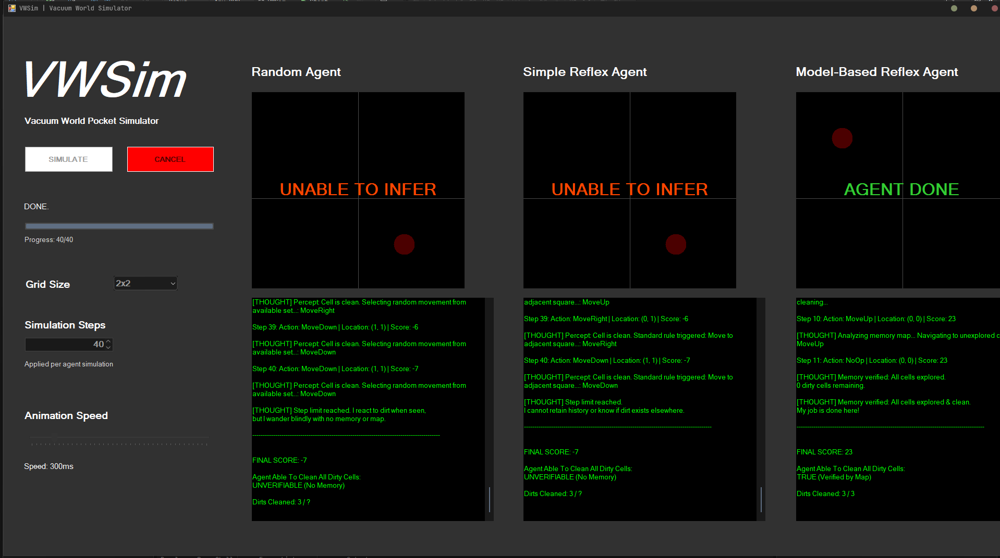

# My Portfolio

# Featured Projects

## 1.) DeskDuck

**Status**: Actively maintaned (release is in beta)

**Role**: Solo developer

**Repository**: [github.com/yerdnarthc/deskduck.git](https://github.com/yerdnarthc/deskduck.git)

**Live demo**: [Open demo](https://github.com/user-attachments/assets/becdb9d4-a428-4406-b764-2e03b87d9025)

### Overview

Sometimes you want music playing in the background while you work. Then another application starts playing something you actually need to hear, and suddenly your music is competing with it. DeskDuck takes care of that little annoyance automatically. It's a small Windows utility that keeps background music out of the way when another app needs your attention.

### My Contribution

- I personally came up with the idea of this app. (well, of course)
- I researched about NAudio, the main open source audio API for .NET in C# that is utilized in the app.
- I developed the app from start to finish, to the first beta release `v1.0.0-beta`.
- I designed the app's color identity and also the app's icon.
- I managed DeskDuck's release process by configuring the build environment, preparing release files, and publishing updated versions of the app.

### Key Features

- Automatically lowers the volume of a selected background-music app when chosen apps begin playing audio.
- Supports two detection modes: session activity for any active playback and audio level for playback above a chosen threshold.
- Lets users configure the duck amount, attack, hold, and release timing, then preview the behavior with **Test Duck**.
- Includes a Sessions window for inspecting active Windows audio sessions and identifying the app currently triggering ducking.
- Provides an event log and system tray controls so the app can run quietly in the background.
- Safely remembers and restores the target app's previous volume after ducking ends.

### Tools Used

- `C#`
- `.NET 10`
- `WPF`
- `NAudio`
- `Windows Audio Sessions`
- `Visual Studio`
- `GitHub Releases`

### Outcome and Next Steps

DeskDuck is available as a `v1.0.1-beta` release for Windows 10 and Windows 11. The main automatic-ducking workflow, diagnostics, configurable timing, and release packaging are in place.

Next, I plan to continue testing DeskDuck with different applications and audio drivers, collect user feedback, polish the beta experience, and prepare future releases.

## 2.) Custom Neofetch-Style Github Profile

**Status**: Completed

**Role**: Solo developer

**Repository**: [github.com/yerdnarthc/yerdnarthc.git](https://github.com/yerdnarthc/yerdnarthc.git)

**No live demo is available**

### Overview

A custom neofetch-style GitHub profile README featuring ASCII art, profile metrics, and automated GitHub stats. Inspired by Andrew6rant.

### My Contribution

- I designed and built the full profile-generation pipeline, from processing a portrait image into ASCII art to rendering the finished Neofetch-style SVG profile.
- I integrated my personal profile details and live GitHub statistics, including repositories, commits, contributions, stars, followers, and code-change totals.
- I configured the GitHub API integration and reusable Python modules that load images, resize them, convert them to grayscale and ASCII characters, and generate the final SVG layout.
- I set up a GitHub Actions workflow that refreshes the dynamic profile statistics every day, commits the updated SVG only when changes exist, and can also be run manually.

### Key Features

- Displays a Neofetch-inspired GitHub profile README with an ASCII-art portrait rendered as an SVG.
- Shows dynamic GitHub data, including public repositories, commits, contributions, stars, followers, and total code changes.
- Generates the profile "uptime" from my birth date using Philippine time.
- Refreshes the dynamic statistics daily through GitHub Actions, while also allowing a manual workflow run.
- Commits and pushes a new `profile.svg` only when the generated output has changed.

### Tools Used

- `Python`
- `Pillow`
- `SVG`
- `GitHub REST API` and `GitHub GraphQL API`
- `GitHub Actions`
- `pytest`

### Outcome and Next Steps

The project produces a custom GitHub profile README with a generated SVG that combines my ASCII-art portrait, personal profile information, and current GitHub statistics. Its GitHub Actions workflow keeps the displayed data current each day without requiring manual updates.

The current implementation is complete. I will maintain the workflow and may refine the profile's visual design or add useful statistics as my GitHub profile develops.

## 3.) N-Queens Hill Climbing Visualizer

**Status:** In development

**Role:** Solo developer

**Repository:** [github.com/yerdnarthc/n-queens-hill-climbing-visualizer.git](https://github.com/yerdnarthc/n-queens-hill-climbing-visualizer.git)

**No live demo is available**

### Overview

An interactive educational visualizer for the N-Queens problem solved with **hill climbing** — featuring a real-time optimization landscape, convergence analytics, time-travel playback, and five hill-climbing strategies plus sideways-move & random-restart policies.

### My Contribution

- I designed and developed the interactive visualizer, turning the N-Queens problem and hill-climbing theory into a hands-on learning experience.
- I implemented a deterministic TypeScript simulation engine with five search strategies, plus sideways-move and random-restart policies.
- I built the visual learning tools, including the animated chessboard, optimization landscape, convergence analytics, and time-travel playback controls.
- I added reproducible seeded runs, shareable URL configuration, CSV export, keyboard shortcuts, and a responsive dark-first interface.
- I organized the project into a reusable algorithm engine, React components, state stores, and hooks, then added unit, component, and end-to-end tests.

### Key Features

* **Interactive chessboard:** (N = 4–16) with animated queen moves and conflict highlighting.
* **Five hill-climbing strategies + two policies**: Steepest-Ascent, First-Choice, Stochastic (Random), Min-Conflicts, Simulated Annealing, plus Sideways-move & Random-Restart policies.
* **Optimization landscape** (hill-up view) — see improving steps, plateaus (shoulders), local maxima, and the global maximum.
* **Real-time analytics** — conflicts-over-iterations convergence chart.
* **Time-travel scrubber** — replay any step of the run, with restart/event markers.
* **Reproducible runs** — seeded RNG, shareable URL state, CSV export.
* **Keyboard shortcuts** — Space = play/pause, ←/→ = step back/forward, R = reset.
* **Dark-first "Midnight Lab" theme** with light-mode toggle.

### Tools Used

- `Next.js`
- `React`
- `TypeScript`
- `Tailwind CSS`
- `Zustand`
- `ECharts`
- `shadcn/ui`
- `Framer Motion`
- `Vitest`, `React Testing Library`, and `Playwright`

### Outcome and Next Steps

The project is a working, locally runnable educational visualizer that lets users compare hill-climbing strategies and inspect each run through charts, playback, and exported data. Its deterministic simulation engine and automated test coverage make individual runs reproducible and easier to validate.

It is still in development. Next, I plan to continue refining the learning experience, improve the visualizer based on testing, and prepare the project for a Vercel deployment.

# More Projects

## 1.) BantAI Buddy Extension

**Status:** In development

**Role:** AI Backend Engineer

**Repository:** [github.com/yerdnarthc/bantAI-buddy.git](https://github.com/yerdnarthc/bantAI-buddy.git)

**Live demo: [Open demo](https://drive.google.com/file/d/1yL_beQiWQrv-zvm62H7zZ29wDpkSf7BK/view?usp=sharing)**

### Overview

BantAI Buddy is an intelligent browser extension designed to enhance user interaction and provide real-time content analysis through a sophisticated AI-powered pipeline. It integrates a lightweight Chrome extension with a robust Node.js backend to deliver seamless AI assistance and content moderation directly within the browser.

### My Contribution

- I was primarily responsible for the AI backend pipeline, including the API flow that sends browser content for analysis, applies the moderation prompt, communicates with the LLM, and returns structured results to the extension.
- I contributed to the explanation pipeline, which turns a moderation result into a constructive educational response instead of only blocking the message.
- I implemented DOM manipulation and `MutationObserver` based logic that detects changing chat content for analysis.
- I built the pipeline for injecting blur CSS styles into chat message containers when the AI analysis identifies content that should be blocked.
- I helped connect the backend analysis results to the extension's content scripts so that the browser can react to moderation decisions in real time.

### Key Features

* **Real-time Content Observation**: High-performance observers (`ApplicationObserver`, `ConversationObserver`) that monitor DOM changes with minimal overhead.
* **Intelligent Content Filtering**: Automatic blurring of content that violates safety or policy guidelines based on AI analysis.
* **Educational Explanations**: Instead of simple blocking, the system provides "learning moments" through an explanation engine.
* **Safety Regression Suite**: A Python-based framework to validate AI responses against a golden dataset, ensuring consistency and safety.
* **Persistent Caching**: A robust caching mechanism that survives page and extension reloads, significantly reducing redundant API calls and improving response times.

### Tools Used

- `Node.js`
- `Express`
- `JavaScript (ES6+)`
- `Chrome Extension Manifest V3`
- `HTML5` and `CSS3`
- `MutationObserver` and DOM APIs
- `LLM API` integration
- `Python` and `JSON` for safety-regression testing

### Outcome and Next Steps

The project is an in-development browser-extension prototype that can observe supported chat content, send it through an AI moderation pipeline, blur flagged messages, and provide educational explanations. It also includes caching and a safety-regression suite to support more reliable AI responses.

Next, the team plans to expand support to more messaging platforms, add a fallback for LLM downtime, and let users define their own blocking keywords through the extension popup.

## 2.) VWSim: Vacuum World Agent Simulator

**Status:** Completed

**Role:** Solo developer

**Repository:** [github.com/yerdnarthc/vwsim.git](https://github.com/yerdnarthc/vwsim.git)

**No live demo is available**

### Overview

The vacuum world is a well-known problem in AI where an agent must navigate a grid environment and clean dirty cells. This simulator application demonstrates how different agent architectures—from simple random behavior to sophisticated model-based reasoning—approach this task.

### My Contribution

- I designed and developed the entire application, from the core simulation model to the Windows Forms interface and console runner.
- I implemented the Random, Simple Reflex, and Model-Based Reflex agents to demonstrate increasing levels of decision-making sophistication.
- I built the model-based agent's internal map, boundary tracking, clean-and-dirty cell records, and breadth-first-search navigation to unexplored cells.
- I created the environment, percept, scoring, and simulation-orchestration logic that drives each agent's interaction with the vacuum world.
- I developed the real-time visualization, side-by-side agent panels, reasoning logs, progress display, and controls for grid size, simulation steps, and animation speed.

### Key Features

* Three agent types: Random, Simple Reflex, and Model-Based Reflex.
* Real-time Windows Forms visualization with performance comparison.
* Asynchronous simulation with cancellation support.
* Performance scoring and internal agent reasoning logs.

### Tools Used

- `C#`
- `.NET Standard 2.0`
- `.NET Framework 4.7.2`
- `.NET 10`
- `Windows Forms`
- `Visual Studio`

### Outcome and Next Steps

The project is complete and provides both a Windows Forms visualizer for comparing agent behavior in real time and a .NET console runner for quick testing. It demonstrates how different AI agent architectures perform in the same vacuum-world environment through scores, progress, and internal reasoning logs.

I will maintain the project as a learning reference and may extend it with additional agent architectures or comparison metrics in future iterations.

